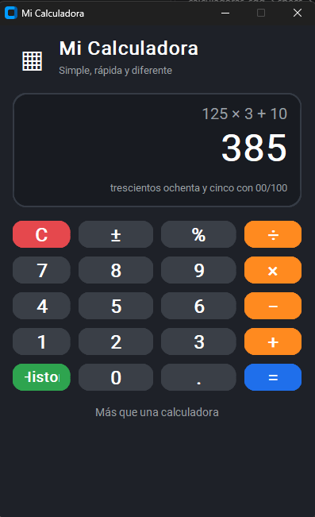

# Calculadoras SDD

Proyecto de práctica de **Spec Driven Development (SDD)** con calculadoras en Python y Java.

## Versiones

| Calculadora | Lenguaje | Herramienta de IA | Ubicación |
|---|---|---|---|
| v2 – Clean Architecture con interfaz gráfica | Python | GitHub Copilot | `src/`, `tests/`, `main.py` |
| v1 – Consola | Python | GitHub Copilot | `calculadora-python/` |
| Consola | Java | OpenCode | `calculadora-java/` |

## Función única: número a letras
Debajo del resultado se muestra el número escrito en palabras con formato de factura.
Ejemplo: `385` → *trescientos ochenta y cinco con 00/100*.

El "00/100" representa los centavos, como en facturas y cheques, para que el valor no se pueda alterar.

## Arquitectura (Clean Architecture)

    src/calculadora/
        domain/          -> reglas puras: operaciones, cálculo, número a letras
        application/     -> casos de uso, controlador y puertos
        infrastructure/  -> ventana (CustomTkinter) y repositorio JSON
    tests/calculadora/   -> pruebas espejo de cada capa
    main.py              -> punto de entrada; conecta las capas

Regla de dependencia: domain no conoce a nadie; application solo conoce domain; infrastructure conoce a ambos.

## Cómo ejecutar
    python -m pip install -r requirements.txt
    python main.py

## Cómo probar
    python -m unittest discover -s tests -t . -v

## Flujo SDD
Cada funcionalidad tiene su spec en `specs/`:
- 001 Calculadora Python (consola)
- 002 Calculadora Java (consola)
- 003 Núcleo con Clean Architecture
- 004 Interfaz gráfica
- 005 Historial
- 006 Número a letras

Reglas del proyecto: `.specify/memory/constitution.md` · Instrucciones para la IA: `AGENTS.md` · Skills: `.github/skills/` · Investigación: `docs/investigacion-clean-architecture.md`